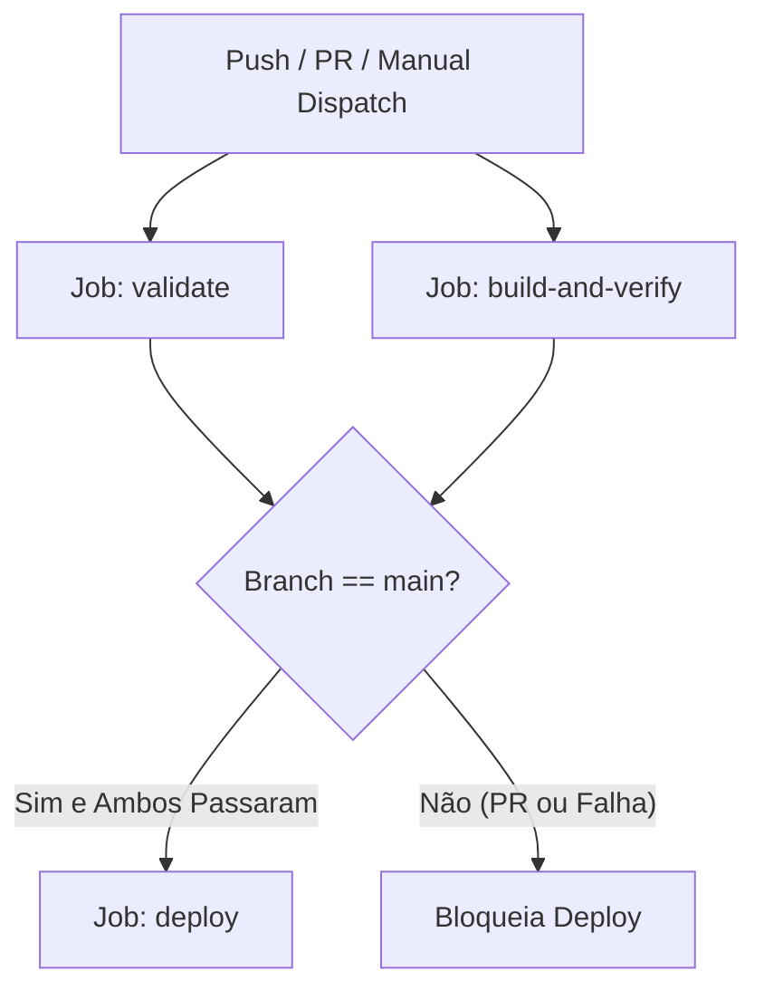

# F1 Portal

Um portal estático desenvolvido com Vanilla JavaScript para consulta de dados publicados da Fórmula 1. O projeto foca em performance, acessibilidade e resiliência, utilizando técnicas modernas de desenvolvimento web sem a dependência de frameworks pesados.

Acesse a demonstração: [https://andersoncav.github.io/F1/](https://andersoncav.github.io/F1/)

## 🏎️ O Projeto

O objetivo deste portal é fornecer uma interface rápida e intuitiva para entusiastas da categoria. Ele consome dados da Jolpica F1 API (sucessora da Ergast) e implementa uma camada robusta de cache local para contornar limites de taxa e garantir funcionamento offline parcial via PWA.

### Diferenciais Técnicos

- **Arquitetura Vanilla:** Zero frameworks. Todo o gerenciamento de estado e DOM é feito via JavaScript puro, demonstrando domínio dos fundamentos da web.
- **Persistência Seletiva:** Sistema de cache customizado em `localStorage` com controle de expiração (TTL) e limpeza granular por projeto.
- **Performance e PWA:** Implementação de Service Worker para cache de assets estáticos e manifesto para instalação como aplicativo.
- **Acessibilidade Real:** Marcação semântica, suporte a leitores de tela via `aria-live` e gestão de foco para navegação por teclado.
- **CI/CD End-to-End:** Pipeline automatizado com GitHub Actions, build de produção isolado em `dist/`, gates de qualidade bloqueantes e deploy seguro para GitHub Pages.

## ✨ Funcionalidades

- **Dashboard:** Próximo Grande Prêmio com contagem até o horário programado e resultados da última corrida.
- **Classificação Dinâmica:** Tabelas de pilotos e construtores com filtros e ordenação personalizada.
- **Grid Completo:** Detalhes técnicos de equipes e pilotos, incluindo fotos e estatísticas históricas.
- **Histórico de Campeões:** Galeria completa de todos os campeões mundiais desde 1950.
- **Calendário:** Cronograma da temporada com status atualizado de cada etapa.

## 🛠️ Stack Técnica

- **Linguagens:** HTML5, CSS3, JavaScript (ES6+ Modules)
- **API:** [Jolpica F1 API](https://github.com/jolpica/jolpica-f1)
- **Infra:** GitHub Actions (Deploy automatizado com gates de qualidade), GitHub Pages
- **Testes & Automação:** Node.js Test Runner nativo (219 testes unitários/integridade) e Playwright Chromium (35 testes de navegador controlados)

## 📂 Estrutura

```text
├── assets/
│   ├── css/                  # Estilos globais e animações
│   ├── images/               # Placeholders e imagens estáticas locais
│   └── js/                   # Módulos ES6 (camada de dados, modelos e UI)
├── dist/                     # Saída explícita do build de produção (ignorado no Git)
├── docs/                     # Relatórios técnicos e evidências de auditoria
│   ├── phase-1.1/
│   ├── phase-2/
│   └── phase-3/
├── scripts/                  # Scripts de build, validação e qualidade
├── tests/                    # Suíte completa de testes (Node nativo e browser)
│   ├── browser/              # Cenários de navegador e testes live
│   └── helpers/              # Servidor HTTP efêmero, mocks e fixtures
├── .github/workflows/
│   ├── deploy.yml            # Pipeline principal (validação, build e deploy)
│   └── live-audit.yml        # Auditoria semanal e manual de serviços externos
├── sw.js                     # Service Worker v5 (shell offline com 25 recursos)
├── manifest.json             # Manifesto PWA
├── package.json              # Scripts e devDependencies (Playwright)
└── 404.html                  # Página de erro com bootstrap de caminho canônico
```

---

## 🚀 CI/CD, Build e Qualidade — Fase 3

O [relatório técnico da Fase 3](docs/phase-3/REPORT.md) detalha a arquitetura do pipeline, evidências e critérios de aceite.

### 1. Pré-requisitos de Desenvolvimento

- **Node.js:** Versão 20+ ou 22 LTS (ambiente de CI padronizado no Node.js 22 LTS).
- **npm:** Versão 10+.
- **Navegador (para testes locais):** Google Chrome ou Chromium gerenciado pelo Playwright.

### 2. Instalação Limpa

Para instalar as dependências de desenvolvimento de forma determinística via lockfile:

```bash
npm ci
```

*(Zero dependências de runtime de produção. Apenas Playwright é mantido em `devDependencies` para os testes de navegador controlados).*

### 3. Comandos de Validação e Qualidade

| Comando | Descrição |
| :--- | :--- |
| `npm test` | Executa todos os 219 testes nativos do Node (sem dependências externas) |
| `npm run check:syntax` | Valida sintaxe JavaScript (`node --check`) em todos os 47 arquivos `.js`/`.mjs` |
| `npm run check:csp` | Valida consistência e sincronização de CSP em todas as páginas HTML |
| `npm run sync:csp` | Sincroniza a política centralizada de CSP entre os arquivos HTML |
| `npm run check:whitespace` | Valida ausência de espaços em branco espúrios no Git (`git diff --check`) |
| `npm run check:budget` | Valida budgets de tamanho de pacote, CSS e JS da pasta `dist/` |
| `npm run check:all` | Executa todos os quality gates e a suíte completa de testes unitários |
| `npm run test:browser` | Executa os 35 testes determinísticos de navegador no Chrome/Playwright |

### 4. Build de Produção Explícito (`dist/`)

O portal não publica mais a raiz do repositório. O comando de empacotamento cria um diretório limpo e auto-contido:

```bash
npm run build
```

- **Origem:** Raiz do projeto
- **Destino:** Diretório `dist/`
- **Conteúdo incluído:** Exatamente 27 arquivos essenciais (6 páginas HTML, 1 Service Worker, 1 Manifesto, 1 `.nojekyll`, 2 folhas de estilo CSS, 1 imagem placeholder SVG e 15 módulos ES6).
- **Conteúdo excluído:** Testes, fixtures, relatórios de auditoria, scripts internos, `.git/`, `.github/`, `node_modules/`, arquivos de configuração e documentação.

### 5. Verificação do Artefato de Produção

Após o build, valide a integridade estrutural, resolução de dependências, integridade de precache do Service Worker e ausência de arquivos proibidos com:

```bash
npm run check:dist
```

### 6. Preview Local de Produção

Para testar o artefato compilado em um servidor HTTP isolado atendendo exclusivamente sob o path `/F1/`:

```bash
npm run preview
```

O servidor iniciará localmente (padrão em `http://127.0.0.1:8080/F1/`).

### 7. Configuração e Execução de Testes de Navegador

Os testes controlados utilizam o Playwright para subir instâncias headless do Chromium/Chrome:

```bash
# Instala os binários do Chromium com dependências do sistema
npx playwright install --with-deps chromium

# Executa os 35 testes de navegador
npm run test:browser
```

Variáveis de ambiente opcionais suportadas pelo harness:
- `F1_PLAYWRIGHT_MODULE`: Caminho alternativo para módulo Playwright pré-instalado.
- `F1_BROWSER_EXECUTABLE`: Caminho absoluto para executável customizado do Chrome.
- `F1_BROWSER_CHANNEL`: Canal do navegador (ex.: `chrome`, `chromium` ou vazio).

### 8. Pipeline do GitHub Actions (`.github/workflows/deploy.yml`)

O workflow é dividido em três estágios estritos com dependências explícitas:



1. **Job `validate`:** Executa validação de sintaxe, CSP, whitespace, os 219 testes nativos do Node e os 35 testes do Chrome. Requer permissão mínima `contents: read`.
2. **Job `build-and-verify`:** Gera o diretório `dist/`, executa `verify-dist`, valida budgets de tamanho, executa testes de servidor isolado contra `dist/` e publica o artefato `production-dist`.
3. **Job `deploy`:** Depende obrigatoriamente de `validate` e `build-and-verify`. Executa **apenas** em pushes para a branch `main` ou `workflow_dispatch` na `main`. Baixa o artefato `production-dist` e publica via `upload-pages-artifact` apontando para `dist/` (jamais `.`). Recebe permissões `pages: write` e `id-token: write`. Pull requests **nunca** realizam deploy.

### 9. Procedimento de Rollback e Segurança

Caso um deploy publicado apresente comportamento indesejado:

1. **Identificação da Revisão:** Cada execução do pipeline registra o commit exato (`GITHUB_SHA`) associado ao artefato gerado.
2. **Rollback via Git:** Realize um revert do commit problemático na branch `main`:
   ```bash
   git revert <commit-hash>
   git push origin main
   ```
3. **Validação Automática:** O push disparará o pipeline completo, executando todos os gates de qualidade antes de publicar a versão restaurada.
4. **Comportamento do Service Worker:** O Service Worker utiliza isolamento de namespace (`f1-portal:<base>:static-v5`). Ao restaurar uma versão com mesmo `CACHE_VERSION`, clientes ativos recebem o cache correspondente. Se o rollback envolver mudança de versão de cache, fechar as abas do navegador ativa o worker em espera.

### 10. Auditorias de Serviços Externos (`.github/workflows/live-audit.yml`)

Para evitar falsos positivos no pipeline de produção decorrentes de instabilidades momentâneas da Jolpica ou do Wikimedia Commons, as checagens com rede real são isoladas e agendadas semanalmente (segundas-feiras às 12:00 UTC) ou acionadas manualmente via `workflow_dispatch`:

```bash
npm run test:api:live        # Verifica disponibilidade dos endpoints da Jolpica
npm run audit:images:live    # Verifica integridade das fotos e licenças no Wikimedia Commons
npm run test:browser:live    # Teste ponta a ponta com rede real
```

### 11. Limitações Conhecidas da Plataforma

- **Hospedagem Estática (GitHub Pages):** Não permite cabeçalhos HTTP customizados de servidor; a CSP é obrigatoriamente aplicada via `<meta http-equiv="Content-Security-Policy">`.
- **Roteamento SPA:** Rotas aninhadas inexistentes dependem de `404.html` com script canônico inline bootstrap para resolver caminhos relativos ao path base `/F1/`.
- **Provedores Externos:** A Jolpica F1 API e Wikimedia Commons são serviços públicos gratuitos sujeitos a rate limiting e indisponibilidade externa.

---

## 🔒 Cache, Recuperação e CSP

- `api.js` controla a validade dos dados da Jolpica. Uma resposta HTTP válida, JSON e com a coleção esperada recebe um único timestamp; leituras do cache nunca renovam esse horário. As requisições reais usam `cache: "no-store"` e timeout de 10 segundos.
- Dados com menos de 60 minutos são reutilizados. Se a rede falhar após esse prazo ou durante RELOAD, o último dado válido pode ser mostrado por até 7 dias, com o aviso **DADOS SALVOS · SEM ATUALIZAÇÃO** e sua data original. Sem dados utilizáveis, a página oferece tentar novamente.
- RELOAD força uma consulta na próxima navegação usando o parâmetro temporário `f1-refresh=1`, removido da URL ao iniciar. Ele preserva filtros e dados anteriores até a atualização terminar. Não apaga preferências, outros projetos ou todo o `localStorage`. Quando o armazenamento é bloqueado, o cache em memória atende a página atual; ele não persiste após navegar.
- O cache da API é limitado a 64 entradas reconhecidas do portal. Na gravação de dados válidos, entradas fora da retenção ou excedentes são removidas. Outros nomes de armazenamento são preservados.
- O Service Worker guarda somente os 25 recursos locais do shell em `f1-portal:<diretório>:static-v5`. Não guarda API, fontes ou imagens de terceiros. O diretório inicial e parâmetros das páginas/CSS são normalizados para as entradas do shell. O shell e o placeholder funcionam offline após uma instalação bem-sucedida; dados nunca consultados online podem ficar indisponíveis offline.
- **Ao alterar qualquer recurso do shell, incremente `CACHE_VERSION` em `sw.js`.** O precache usa `addAll`, verifica status/MIME/redirecionamentos e rejeita a instalação incompleta. O worker anterior continua atendendo suas abas; feche as abas do portal para ativar uma versão em espera. A ativação remove apenas o namespace desse diretório e os nomes legados exatos `f1-portal-v<número>`, incluindo o antigo `v13`.
- A fonte única da política é `scripts/sync-csp.mjs`: execute `npm run sync:csp` após editar a política ou o pequeno script de base da 404. `npm run check:csp` detecta divergências em todas as páginas. Não há `unsafe-inline`, `unsafe-eval` ou hosts curinga. O único script inline, necessário para caminhos 404 aninhados, é autorizado pelo hash exato.
- A CSP em `<meta>` precisa aparecer antes dos recursos; ela não oferece `frame-ancestors`, `sandbox`, modo Report-Only nem relatórios de violação equivalentes aos cabeçalhos HTTP. A 404 usa a raiz local ou o diretório `F1` informado pela URL canônica; ao renomear o projeto, atualize essa URL e sincronize a CSP.
- Imagens externas usam o placeholder local uma única vez em caso de erro. A disponibilidade dos arquivos remotos continua dependendo dos provedores.

---

## 📊 Integridade dos Dados — Fase 2

O [relatório técnico da Fase 2](docs/phase-2/REPORT.md) registra fontes, correções e resultados. A galeria contém os **35 campeões de 1950 a 2025**, incluindo Giuseppe Farina e Lando Norris. Os 33 retratos da fase 1.1 e seus créditos foram preservados; as aprovações constam em [image-audit.json](docs/phase-2/image-audit.json).

- A temporada vem das respostas da Jolpica. Consultas relacionadas usam esse ano explicitamente; o ano do navegador não decide a temporada. Nomes de corridas preservam o nome esportivo da API.
- Posição, pontos e vitórias de GP pertencem à classificação da temporada. Pontos incluem sprints; vitórias de GP não incluem sprints. Número permanente, nascimento e nacionalidade vêm do perfil da API.
- Vitórias históricas e títulos têm recorte **até 2025**. Construtores não herdam automaticamente resultados de organizações anteriores. Pilotos listados são participantes da temporada, incluindo substitutos.
- Metadados técnicos das equipes são snapshots das páginas oficiais da F1, verificados em 01/11/2026 e válidos para a temporada indicada.
- Uma largada passada sem resultado confirmado gera **AGUARDANDO RESULTADO**. Conclusão exige resultado publicado da mesma temporada, etapa, circuito e data. Horário ausente não vira meio-dia; o contador termina sem anunciar transmissão ao vivo.
- A validação de domínio rejeita identidades ausentes, duplicatas, temporada incorreta, paginação incompleta e regressões sobre snapshots válidos.

---

## 📸 Fotografias dos Campeões — Fase 1.1

As 33 fotografias históricas usam URLs verificadas retornadas por `prop=imageinfo` da API oficial do Wikimedia Commons, com largura solicitada de 250px para retratos de 100px. Hawthorn usa o original de 217×308px devolvido pela própria API.

Cada registro mantém somente `photo` e `photoCredit` (atribuição, página da fonte, licença e link dos termos). Os créditos ficam acessíveis abaixo das estatísticas. As imagens continuam externas, lazy e fora do precache. O [relatório da fase 1.1](docs/phase-1.1/REPORT.md) contém a auditoria por campeão, licenças e evidências.

---

Desenvolvido por [Anderson Cavalcante](https://github.com/AndersonCav)
