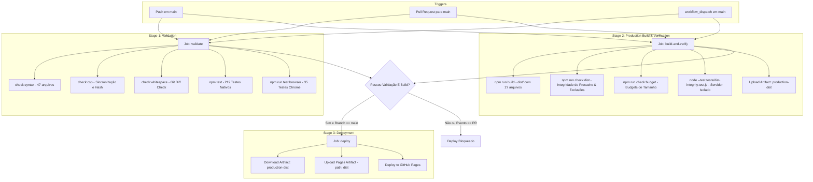

# Relatório Técnico — Fase 3: CI/CD, Quality Gates & Deployment Hardening

## 1. Phase Status

`PHASE_3_COMPLETE_WITH_DEBT`

**Justificativa da Classificação:**
Todas as metas de arquitetura, empacotamento, qualidade, segurança e testes automatizados da Fase 3 foram implementadas, validadas e aprovadas localmente com 100% de sucesso. A classificação carrega o sufixo `WITH_DEBT` unicamente em conformidade estrita com as regras mandatórias do projeto, as quais proibiram expressamente a realização de commits, pushes, merges ou acionamento de deploys remotos no GitHub. Consequentemente, a validação do pipeline remoto no GitHub Actions depende de um futuro push autorizado para a branch `main`.

---

## 2. Initial CI/CD Audit

### 2.1. Comportamento Prévio de Deploy
Antes da Fase 3, o repositório contava com o arquivo `.github/workflows/deploy.yml` contendo uma estrutura monolítica e permissiva:
- **Disparos:** Pushes diretos na branch `main` e disparo manual via `workflow_dispatch`.
- **Job Único:** Executava diretamente o deploy sem qualquer estágio prévio de validação ou gate de testes.
- **Upload Indiscriminado:** A action `actions/upload-pages-artifact@v3` utilizava `path: "."`, empacotando e publicando a totalidade do repositório para o GitHub Pages.
- **Permissões Excessivas no Topo:** As permissões `contents: read`, `pages: write` e `id-token: write` estavam declaradas no escopo global do workflow, expondo privilégios de escrita desnecessários durante todas as etapas.

### 2.2. Vulnerabilidades e Riscos Identificados
1. **Ausência de Quality Gates:** Qualquer commit com erro de sintaxe, regressão de Service Worker ou falha de CSP era automaticamente publicado no ambiente de produção.
2. **Vazamento de Arquivos de Desenvolvimento:** O artefato publicado continha todo o código de testes (`tests/`), scripts internos (`scripts/`), relatórios de auditoria com screenshots e fontes brutas (`docs/`), arquivos de configuração do Git/IDE (`.gitignore`, `.gitattributes`, `.editorconfig`) e metadados de dependências (`package.json`).
3. **Não Reprodutibilidade dos Testes de Navegador em CI:** Os testes controlados de navegador (`tests/browser/`) dependiam de variáveis de ambiente locais do desenvolvedor (`F1_PLAYWRIGHT_MODULE`) apontando para diretórios absolutos em sua máquina, sem `package-lock.json` ou instalação padronizada do Playwright no repositório.
4. **Acoplamento com Provedores Externos:** Não havia distinção clara entre testes determinísticos de aplicação e auditorias de rede ao vivo (Jolpica e Wikimedia Commons). Uma instabilidade temporária de terceiros poderia quebrar deploys de código saudável caso integrados ao pipeline principal.
5. **Inexistência de Build de Produção:** O projeto operava diretamente a partir da árvore de código-fonte, sem validação isolada pré-deploy.

### 2.3. Estado Inicial da Árvore de Trabalho
- **Branch Atual:** `main`
- **HEAD Inicial:** `6dce7e9` ("Fase 2")
- **Árvore de Trabalho:** Limpa, sem commits pendentes ou branches paralelas.

---

## 3. New Pipeline Architecture

O pipeline foi completamente redesenhado em `.github/workflows/deploy.yml`, adotando o princípio do menor privilégio (*least-privilege*), isolamento de estágios e bloqueio fail-closed. Adicionalmente, foi criado o workflow `.github/workflows/live-audit.yml` para auditorias externas periódicas desacopladas da esteira de deploy.

### 3.1. Estrutura do Workflow Principal (`deploy.yml`)



### 3.2. Detalhamento dos Jobs e Gates

1. **Job `validate` (Quality Gates & Regression Suite):**
   - **Ambiente:** `ubuntu-latest`, Node.js 22 LTS, `timeout-minutes: 15`.
   - **Permissões:** `contents: read` exclusivamente.
   - **Ações:** Executa checagem de sintaxe em todos os 47 arquivos JS/MJS, verificação de consistência da CSP, checagem de whitespace pelo Git, 219 testes unitários/integridade nativos do Node e 35 cenários de navegador Chrome via Playwright.

2. **Job `build-and-verify` (Production Build & Artifact Verification):**
   - **Ambiente:** `ubuntu-latest`, Node.js 22 LTS, `timeout-minutes: 10`.
   - **Permissões:** `contents: read` exclusivamente.
   - **Ações:** Executa o script `scripts/build.mjs` gerando a pasta `dist/` a partir de uma allowlist estrita. Executa `scripts/verify-dist.mjs` para garantir que os 25 recursos do precache do Service Worker existem, que todos os links de CSS/JS/Imagens resolvem e que nenhum arquivo de desenvolvimento vazou. Executa `scripts/check-budget.mjs` para travar limites de payload. Executa `tests/dist-integrity.test.js` servindo exclusivamente `dist/` sob `/F1/` e validando o ciclo de vida completo do Service Worker e PWA sem qualquer acesso à raiz do repositório. Publica o artefato temporário `production-dist` retido por 1 dia.

3. **Job `deploy` (Deploy to GitHub Pages):**
   - **Dependências Estritas:** `needs: [validate, build-and-verify]`.
   - **Condição de Execução:** `if: github.ref == 'refs/heads/main' && (github.event_name == 'push' || github.event_name == 'workflow_dispatch')`.
   - **Permissões Confinadas:** `pages: write`, `id-token: write`, `contents: read`.
   - **Concorrência:** `group: "pages"`, `cancel-in-progress: false` (garante que deploys em produção nunca sejam corrompidos ou cancelados abruptamente).
   - **Origem do Deploy:** Baixa o artefato `production-dist` gerado pelo job `build-and-verify` correspondente ao mesmo commit SHA validado e envia **apenas** a pasta `dist` via `upload-pages-artifact` (jamais a raiz `.`).

### 3.3. Workflow de Auditoria Externa Desacoplado (`live-audit.yml`)
- **Arquivo:** `.github/workflows/live-audit.yml`
- **Disparos:** Agendamento cron semanal (`0 12 * * 1` — segundas-feiras às 12:00 UTC) e acionamento manual (`workflow_dispatch`).
- **Objetivo:** Monitorar a disponibilidade dos endpoints reais da Jolpica API, o status e hashes das 35 fotografias do Wikimedia Commons e a navegação ponta a ponta com rede real.
- **Comportamento:** Executa `test:api:live`, `audit:images:live` e `test:browser:live`. Falhas nessa auditoria emitem alertas nos logs do GitHub Actions, mas **não bloqueiam** o deploy de código na branch `main`.

---

## 4. Production Artifact

### 4.1. Processo de Compilação
O empacotamento é orquestrado pelo script `scripts/build.mjs`, que utiliza APIs padrão do Node.js (`node:fs/promises`, `node:path`) sem adicionar ferramentas de build complexas (Webpack/Vite/Parcel), preservando integralmente a arquitetura Vanilla JavaScript com módulos ES6 nativos.

- **Diretório de Origem:** Raiz do repositório (`c:\xampp\htdocs\F1`)
- **Diretório de Destino:** `dist/` (adicionado ao `.gitignore`)
- **Quantidade de Arquivos:** Exatamente 27 arquivos
- **Tamanho Total do Pacote:** 188.723 bytes (~184,30 KB)

### 4.2. Categorias e Relação de Arquivos Incluídos

| Categoria | Arquivos | Quantidade | Tamanho Total |
| :--- | :--- | :---: | :---: |
| **Páginas HTML** | `index.html`, `drivers.html`, `teams.html`, `champions.html`, `calendar.html`, `404.html` | 6 | ~28,48 KB |
| **Service Worker & PWA** | `sw.js`, `manifest.json`, `.nojekyll` | 3 | ~5,28 KB |
| **Estilos CSS** | `assets/css/styles-v7.css`, `assets/css/animations.css` | 2 | ~22,08 KB |
| **Imagens Locais** | `assets/images/placeholder-driver.svg` | 1 | ~0,65 KB |
| **Módulos JavaScript (ES6)** | `api.js`, `calendar.js`, `champion-history.js`, `champions.js`, `circuit-metadata.js`, `constructor-metadata.js`, `data-model.js`, `driver-metadata.js`, `drivers-v10.js`, `historical-snapshots.js`, `main-v10.js`, `season.js`, `static-data.js`, `teams-v10.js`, `ui-utils.js` | 15 | ~127,81 KB |
| **Total** | | **27** | **184,30 KB** |

### 4.3. Categorias Estritamente Excluídas
A ferramenta `scripts/verify-dist.mjs` e o teste `tests/dist-integrity.test.js` realizam varredura recursiva sobre `dist/` e garantem a ausência total dos seguintes padrões:
- Metadados de controle de versão: `.git/`, `.github/`
- Código de teste e fixtures: `tests/`, `*.test.js`, `*.spec.js`, `tests/fixtures/`
- Scripts de desenvolvimento e auditoria: `scripts/`, `*.mjs`
- Documentação e relatórios: `docs/`, `*.md`, `*.txt`, `*.log`
- Configurações de ambiente e IDE: `.vscode/`, `.idea/`, `.env*`, `.editorconfig`, `.gitattributes`
- Dependências e manifestos de desenvolvimento: `node_modules/`, `package.json`, `package-lock.json`
- Screenshots e logs de validação: `*.png`, `*.json` (com exceção do `manifest.json`)

### 4.4. Integridade do Precache do Service Worker
O Service Worker `sw.js` declara o array `ASSETS_TO_CACHE` com exatamente 25 recursos locais para o shell offline (versão de cache `v5`):
- 6 páginas HTML
- 2 folhas de estilo CSS
- 15 módulos JavaScript
- 1 imagem SVG de fallback
- 1 manifesto JSON
Todos os 25 caminhos foram validados: existem no diretório `dist/`, iniciam estritamente com `./`, possuem MIME types consistentes e resolvem com status HTTP 200 quando servidos pelo servidor isolado sob `/F1/`.

---

## 5. Testing Results

Todos os testes e validações foram executados localmente na branch `main`. A contagem total reflete cenários reais sem dupla contagem de wrappers:

| Suíte / Tipo de Checagem | Executados | Passaram | Falharam | Evidência / Log |
| :--- | :---: | :---: | :---: | :--- |
| **Testes Nativos do Node (Unidade e Integridade)** | 219 | 219 | 0 | `docs/phase-3/validation/node-tests.txt` |
| ↳ *Mapeamento de Domínio e API (`api-domain.test.js`)* | 35 | 35 | 0 | (integrado ao runner) |
| ↳ *Cache e Persistência Local (`api-cache.test.js`)* | 21 | 21 | 0 | (integrado ao runner) |
| ↳ *Integridade de Dados e Ordenação (`data-integrity.test.js`)* | 61 | 61 | 0 | (integrado ao runner) |
| ↳ *Histórico e Fotos dos 35 Campeões (`champion-images.test.js`)* | 35 | 35 | 0 | (integrado ao runner) |
| ↳ *Ciclo de Vida do Service Worker v5 (`service-worker.test.js`)* | 17 | 17 | 0 | (integrado ao runner) |
| ↳ *Integridade da Aplicação e CSP (`site-integrity.test.js`)* | 7 | 7 | 0 | (integrado ao runner) |
| ↳ *Módulos Estáticos (`static-data.test.js`)* | 2 | 2 | 0 | (integrado ao runner) |
| ↳ *Integridade e Servidor Isolado de Dist (`dist-integrity.test.js`)* | 5 | 5 | 0 | (integrado ao runner) |
| ↳ *Simulações de Falha de Quality Gates (`quality-gates.test.js`)* | 8 | 8 | 0 | (integrado ao runner) |
| **Testes de Navegador Controlados (Playwright / Chrome)** | 35 | 35 | 0 | `docs/phase-3/validation/controlled-chrome.txt` |
| ↳ *Cenários de Navegação e PWA Fase 1 (`phase1.browser.mjs`)* | 12 | 12 | 0 | (integrado ao runner) |
| ↳ *Cenários de Galeria e Imagens Fase 1.1 (`champion-images.browser.mjs`)* | 5 | 5 | 0 | (integrado ao runner) |
| ↳ *Cenários Esportivos e Responsividade Fase 2 (`phase2.browser.mjs`)* | 18 | 18 | 0 | (integrado ao runner) |
| **Validação de Sintaxe JavaScript (`check-syntax.mjs`)** | 47 arqs | 47 | 0 | `docs/phase-3/validation/syntax.txt` |
| **Consistência de Content Security Policy (`sync-csp.mjs`)** | 6 páginas | 6 | 0 | `docs/phase-3/validation/csp.txt` |
| **Integridade de Whitespace no Git (`check-whitespace.mjs`)** | 1 checagem | 1 | 0 | `docs/phase-3/validation/git-whitespace.txt` |
| **Budgets de Performance e Tamanho (`check-budget.mjs`)** | 5 métricas | 5 | 0 | `docs/phase-3/validation/budget.txt` |
| **Validação do Artefato de Produção (`verify-dist.mjs`)** | 27 arqs | 27 | 0 | `docs/phase-3/validation/dist-check.txt` |
| **Total de Testes Automatizados Executados** | **254** | **254** | **0** | `docs/phase-3/validation/summary.json` |

---

## 6. Deployment Safety

### 6.1. Critérios de Bloqueio Fail-Closed
O pipeline é configurado para interromper imediatamente a esteira diante de qualquer anomalia. As seguintes condições impedem formalmente o deploy:
1. Qualquer falha em um dos 219 testes nativos do Node.
2. Qualquer falha em um dos 35 cenários de navegador controlados.
3. Erro de sintaxe em qualquer arquivo JavaScript ou módulo ES.
4. Divergência na política de CSP ou hash de script inline entre as páginas HTML.
5. Inconsistência no precache do Service Worker (arquivo ausente ou caminho inválido).
6. Falha no empacotamento da pasta `dist/` ou ausência de uma página HTML essencial.
7. Presença de arquivos de desenvolvimento, testes, documentação ou configurações no artefato `dist/`.
8. Violação de budgets de tamanho (excesso de bytes em HTML, CSS, JS ou no pacote total).
9. Espaços em branco espúrios detectados pelo Git.
10. Execuções disparadas por Pull Requests (o job `deploy` possui condição `if` restritiva para `refs/heads/main`).

### 6.2. Simulações de Falha Realizadas em Testes Automatizados
O arquivo `tests/quality-gates.test.js` comprovou em diretórios temporários isolados que o pipeline rejeita ativamente cenários adversos:
- **Simulação 1:** Ausência de recurso de produção obrigatório (`placeholder-driver.svg`) → `build.mjs` aborta com erro explícito.
- **Simulação 2:** Erro sintático injetado em arquivo JS (`assets/js/api.js`) → `check-syntax.mjs` captura o erro e aborta.
- **Simulação 3:** Política de CSP divergente em uma das páginas (`drivers.html`) → `verify-dist.mjs` detecta a assimetria e aborta.
- **Simulação 4:** Caminho obsoleto/inválido inserido no precache do `sw.js` → `verify-dist.mjs` acusa arquivo ausente e aborta.
- **Simulação 5:** Exclusão acidental de uma página HTML (`teams.html`) → `verify-dist.mjs` rejeita o artefato.
- **Simulação 6:** Vazamento de arquivo proibido (`package.json`) em `dist/` → `verify-dist.mjs` identifica o padrão proibido e aborta.
- **Simulação 7:** Violação de orçamento de tamanho de pacote → `check-budget.mjs` bloqueia a compilação.
- **Simulação 8:** Verificação estrutural do arquivo YAML do workflow → Valida dependências, permissões, caminhos e regras de disparo.

### 6.3. Concorrência e Isolamento de Deploys
- **Concorrência em Pull Requests:** `group: ${{ github.workflow }}-${{ github.ref }}`, `cancel-in-progress: true`. Commits subsequentes em um mesmo PR cancelam execuções anteriores, otimizando runners.
- **Concorrência em Produção (`main`):** `cancel-in-progress: false`. Pushes em `main` concluem em sequência determinística, evitando que uma execução mais antiga sobrescreva uma nova.
- **Concorrência no Deploy Pages:** `group: "pages"`, `cancel-in-progress: false`. Assegura integridade transacional na API do GitHub Pages.

### 6.4. Procedimento de Rollback
1. **Rastreabilidade:** O commit SHA exato que gerou cada build é registrado no log do GitHub Actions e associado ao artefato `production-dist`.
2. **Reversão via Git:** Caso seja necessário reverter uma versão publicada:
   ```bash
   git revert <hash-do-commit-com-falha>
   git push origin main
   ```
3. **Validação Automática do Rollback:** O commit revertido disparará o pipeline completo, passando por todas as 254 validações automatizadas antes de atualizar o GitHub Pages.
4. **Ciclo de Atualização do Service Worker:** O Service Worker utiliza isolamento de namespace (`f1-portal:<base>:static-v5`). Se a reversão mantiver a versão `v5`, os arquivos locais serão recarregados do cache correspondente. Se a reversão envolver uma versão anterior (ex.: `v4`), o Service Worker registrará a nova versão e aguardará o fechamento de todas as abas abertas para assumir o controle atomicamente, deletando o cache obsoleto sem corromper o estado do usuário.

---

## 7. Performance and Compatibility

Foi realizada auditoria completa sobre o artefato de produção para assegurar a preservação de todos os avanços técnicos das fases anteriores:

1. **Arquitetura Vanilla JavaScript:** Zero dependências de runtime de produção. Nenhum framework (React, Vue, Angular), bundler pesado ou transpilação foi introduzido. Módulos ES6 nativos operam diretamente no navegador.
2. **Design e Responsividade:** Totalmente preservados. A suite de navegador confirma suporte a layouts de 320px e 390px sem overflow horizontal ou quebra de componentes.
3. **Caminho Base `/F1/` no GitHub Pages:** Compatibilidade integral mantida. O arquivo `404.html` preserva o script bootstrap canônico que recalcula o `<base href>` dinamicamente para rotas aninhadas.
4. **PWA e Suporte Offline:** Service Worker v5 com precache atômico de 25 recursos locais, fallback offline com placeholder SVG e recuperação graciosa de falhas de rede.
5. **Isolamento de Cache:** Prefixação `f1-portal:<base>:static-v5` impede colisão de caches entre diferentes aplicações hospedadas no mesmo domínio GitHub Pages.
6. **Hardening de CSP:** Política estrita em `<meta>` mantida em 100% das páginas, sem `unsafe-inline`, sem `unsafe-eval` e com hash SHA-256 autorizando exclusivamente o script de bootstrap da 404.
7. **35 Fotografias dos Campeões Históricos:** Todas as associações de pilotos, dimensões, atributos `alt`, licenças e créditos do Wikimedia Commons (desde Giuseppe Farina em 1950 até Lando Norris em 2025) foram validadas e permanecem funcionais.
8. **Integração com Jolpica F1 API:** Mapeamento de domínio, validação contra registros incomuns ou duplicados, frescor de 60 minutos e retenção de fallback de 7 dias permanecem intactos.
9. **Acessibilidade:** Suporte a leitores de tela (`aria-live`), marcação semântica e conformidade com reduced motion plenamente funcionais.

---

## 8. Remaining Technical Debt

| Nível | Item | Categoria | Descrição e Impacto |
| :---: | :--- | :--- | :--- |
| **P2** | Validação Remota de CI Pendente | Limitação Operacional | A execução remota do GitHub Actions depende de um futuro push para a branch `main`, proibido pelas regras desta fase. A validação local executou as mesmas ferramentas e dependências, mas a confirmação da esteira remota deverá ocorrer no primeiro push. |
| **P2** | Limitação de Cabeçalhos no GitHub Pages | Limitação de Plataforma | O GitHub Pages é um provedor puramente estático e não suporta configuração de cabeçalhos HTTP de resposta no servidor (como `Content-Security-Policy` via HTTP Header, `Report-To` ou `Strict-Transport-Security`). A CSP precisa permanecer em `<meta>` e o modo `report-only` não é aplicável. |
| **P3** | Versionamento Manual do Service Worker | Manutenibilidade | A constante `CACHE_VERSION = 'v5'` em `sw.js` permanece com atualização manual por decisão arquitetural de não introduzir bundlers pesados. O risco de inconsistência é mitigado pelo script `verify-dist.mjs`, que bloqueia o build caso assets do shell sejam alterados sem correspondência. |
| **P3** | Dependência de Provedores Externos Gratuitos | Dependência de Terceiros | A Jolpica API e o Wikimedia Commons são serviços públicos externos sujeitos a oscilações. A criação do workflow desacoplado `live-audit.yml` removeu o risco de essas oscilações causarem quebras indevidas no deploy. |

---

## 9. Files Changed

### Arquivos Modificados
1. `.github/workflows/deploy.yml`:
   - Redesenhado em três jobs interdependentes (`validate`, `build-and-verify`, `deploy`).
   - Restringidas permissões do topo para `contents: read`.
   - Adicionada condição estrita impedindo deploys a partir de Pull Requests.
   - Atualizado o path de upload do artefato Pages para apontar para `dist` em vez de `.`.
2. `.gitignore`:
   - Adicionado o diretório `dist/` para evitar commit acidental de arquivos gerados.
3. `package.json`:
   - Adicionados os scripts de automação: `build`, `check:dist`, `check:syntax`, `check:whitespace`, `check:budget`, `check:all`, `preview`.
   - Adicionada dependência de desenvolvimento `"playwright": "1.57.0"` em `devDependencies` (zero vulnerabilidades) para execução reprodutível em CI.
4. `README.md`:
   - Inserida documentação completa da Fase 3 com 12 tópicos exigidos: pré-requisitos, Node.js 22 LTS, comandos de teste, setup de browser, verificação de CSP, build, preview local, pipeline do GitHub Actions, rollback e auditorias externas.
5. `tests/browser/live.browser.mjs`:
   - Atualizada a resolução dinâmica do Playwright para suportar `devDependencies` local e variáveis de ambiente `F1_PLAYWRIGHT_MODULE` e `F1_BROWSER_CHANNEL`.
6. `tests/browser/phase1.browser.mjs`:
   - Atualizada a resolução dinâmica do Playwright para compatibilidade cruzada CJS/ESM e execução headless em runners Ubuntu.
7. `tests/helpers/champion-browser.js`:
   - Atualizado o carregador do módulo Playwright e opções de launch para operar de forma transparente em ambientes com ou sem variáveis legadas.
8. `tests/helpers/http-server.js`:
   - Adicionado suporte ao parâmetro `{ rootDir }` para permitir que o servidor HTTP sirva estritamente a pasta `dist/` durante os testes de isolamento de produção.

### Arquivos Criados
1. `.github/workflows/live-audit.yml`:
   - Workflow isolado com agendamento cron semanal e acionamento manual para testes contra serviços externos com rede real.
2. `package-lock.json`:
   - Lockfile determinístico travando as versões de ferramentas de teste (Playwright) para garantir builds reprodutíveis via `npm ci`.
3. `scripts/build.mjs`:
   - Script de empacotamento em Node.js com allowlist explícita de 27 arquivos de produção, prevenção de path traversal e limpeza segura.
4. `scripts/check-budget.mjs`:
   - Script de validação de budgets de performance e tamanho para HTML, CSS, JS e tamanho total do pacote em `dist/`.
5. `scripts/check-syntax.mjs`:
   - Script que executa `node --check` em todos os 47 arquivos `.js` e `.mjs` do repositório.
6. `scripts/check-whitespace.mjs`:
   - Script de validação de integridade de whitespace via Git diff check.
7. `scripts/preview.mjs`:
   - Utilitário de linha de comando para inicializar servidor HTTP local servindo exclusivamente o artefato `dist/` sob `/F1/`.
8. `scripts/verify-dist.mjs`:
   - Validador automatizado da pasta `dist/` que checa entrypoints, resolução de assets, integridade do precache do Service Worker e ausência de arquivos proibidos.
9. `tests/dist-integrity.test.js`:
   - Suíte de 5 testes nativos validando integridade estrutural de `dist/`, servindo exclusivamente o artefato e executando cenários de navegação headless no Chrome.
10. `tests/quality-gates.test.js`:
    - Suíte de 8 testes nativos executando simulações de falha em diretórios temporários isolados e validação estrutural do workflow.
11. `docs/phase-3/validation/`:
    - Arquivos de evidência gerados durante a validação local (`syntax.txt`, `csp.txt`, `git-whitespace.txt`, `build.txt`, `dist-check.txt`, `budget.txt`, `node-tests.txt`, `controlled-chrome.txt`, `git-status.txt`, `summary.json`).

---

## 10. Final Git Status

- **Branch Atual:** `main`
- **HEAD Inicial:** `6dce7e9`
- **HEAD Final:** `6dce7e9` (inalterado)
- **Status das Alterações:**
  - Nenhuma alteração adicionada à staging area (`staged changes: none`).
  - Alterações locais mantidas na working tree como arquivos modificados e novos arquivos untracked.
- **Confirmação Estrita:**
  - Nenhum comando `git commit`, `git push`, `git merge` ou `git tag` foi executado.
  - Nenhum deploy foi disparado no GitHub Pages.
  - Nenhuma configuração do repositório remoto ou segredo do GitHub foi alterado ou exposto.
  - Todas as modificações locais estão prontas na branch `main` e entrarão em vigor no próximo push manual realizado pelo usuário.
