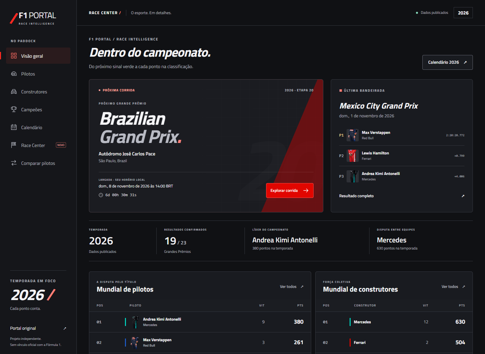
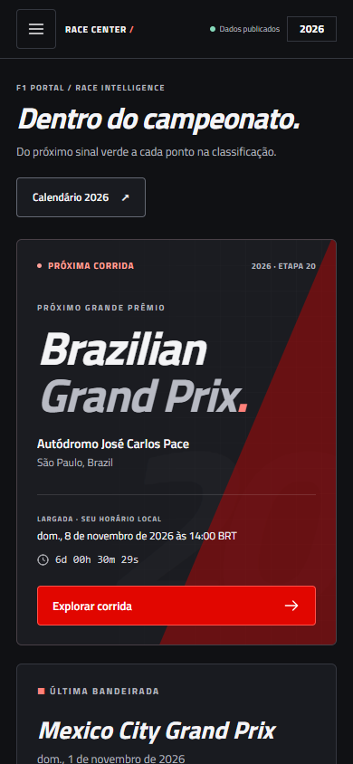

# Phase 5 visual evidence

The main gallery uses real Jolpica responses and the project's existing verified photograph URLs in Chrome, without mocked providers or a frozen clock. Exact capture timestamps, routes, image decode results and any remote-image fallbacks are in [visuals.json](validation/visuals.json). A source photograph that fails remains an explicitly unavailable silhouette; it is not replaced with an invented portrait.

| Desktop dashboard | Mobile dashboard |
| --- | --- |
|  |  |

| Experience | Screenshot | What to inspect |
| --- | --- | --- |
| Drivers | [Grid](screenshots/drivers.png), [expanded profile](screenshots/drivers-expanded.png) | Portraits, team accents, controls, season points and source detail |
| Constructors | [Team rankings](screenshots/constructors.png) | Cars, current points, participants and dated metadata |
| Champions | [Historical gallery](screenshots/champions.png) | Existing photographs, title years and licensing disclosure |
| Calendar | [Race timeline](screenshots/calendar.png) | Distinct confirmed/pending/programmed status and local dates |
| Race Center | [Published result](screenshots/race-center.png) | Functional selectors and real finishing positions/times |
| Comparison | [Head to head](screenshots/comparison.png) | Season metrics, historical scope, charts and table alternative |

## Controlled states — test evidence only

These captures deliberately use a fixed reference clock and recorded source responses. Remote photographs are replaced with the existing local SVG to make layout tests deterministic. The empty, error and loading states are artificial transport conditions, and the long name is explicitly synthetic. They are not promotional sporting-data screenshots.

| State | Screenshot |
| --- | --- |
| Loading | [Static loading feedback](screenshots/test-loading.png) |
| Empty | [No published records](screenshots/test-empty.png) |
| Failure | [Retry feedback](screenshots/test-error.png) |
| Stress case | [Expanded profile, long test name and missing photo at 320px](screenshots/test-long-name-missing-image.png) |

Responsive overflow checks additionally cover all seven routes at 320, 375, 390, 768, 1024 and 1440px, plus a meaningful 844×390 landscape layout. Curated screenshots are viewport captures; they are not evidence that every offscreen lazy image has loaded. The independent legacy live photograph audit checks all 35 historical image sources and decodes separately.
